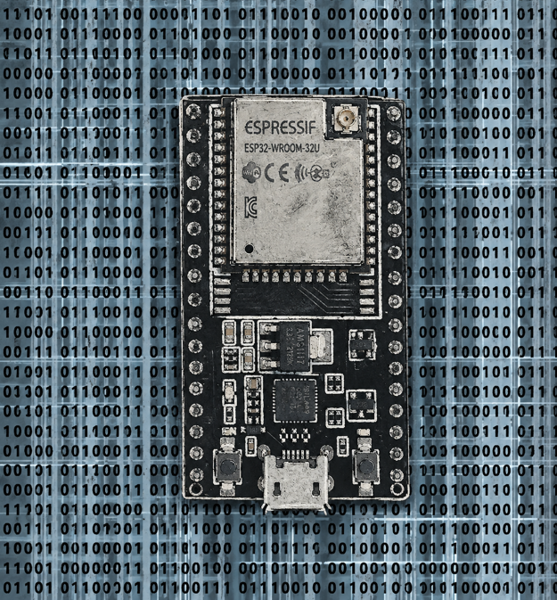
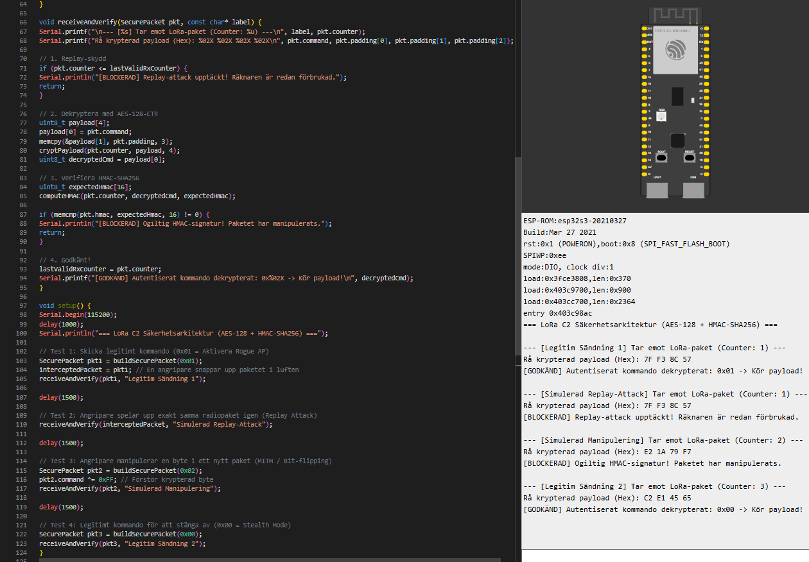

# Cryptolora-c2

Cryptographic Out-of-Band LoRa C2 protocol for ESP32-S3 implementing AES-128-CTR encryption, 
HMAC-SHA256 authentication, and rolling-counter replay protection.

A cryptographically secured Command & Control (C2) communication protocol built in C++ for **ESP32-S3** and **868 MHz LoRa**. This project demonstrates how hardware implants and IoT devices can be controlled *Out-of-Band* (without relying on local Wi-Fi, internet access, or cellular networks) with robust protection against eavesdropping, tampering, and replay attacks.

---

##  Purpose & Security Architecture

Standard LoRa transmissions are frequently sent in plaintext or with minimal encryption, leaving devices vulnerable to passive sniffing and replay of captured radio frames.

This project implements a **24-byte binary protocol** that secures communication across three layers using the ESP32's hardware-accelerated `mbedtls` library:

1. **Confidentiality (`AES-128-CTR`):** The command byte and padding are symmetrically encrypted prior to transmission, preventing unauthorized listeners on 868 MHz from reading the payload.
2. **Integrity & Authentication (`HMAC-SHA256`):** Each packet is signed using a 256-bit pre-shared secret key (truncated to 128 bits in the frame). If an attacker alters even a single bit in transit, the packet is immediately rejected.
3. **Replay Protection (Rolling Counter / Nonce):** Every message includes a strictly incrementing 32-bit counter (`counter`). The receiver tracks the last valid value and drops any packet with an equal or lower counter.

---

## 🛡️ Packet Structure (24 Bytes)

| Field | Size | Description |
| :--- | :--- | :--- |
| `counter` | 4 bytes (`uint32_t`) | Rolling counter acting as a Nonce/IV to prevent replay attacks. |
| `command` | 1 byte (`uint8_t`) | Encrypted control command (e.g., `0x00` = Stealth/Off, `0x01` = Mode 1, `0x02` = Mode 2). |
| `padding` | 3 bytes (`uint8_t`) | Encrypted padding to obfuscate exact message structure. |
| `hmac` | 16 bytes (`uint8_t`) | Truncated HMAC-SHA256 signature computed over `counter` and plaintext `command`. |

---

## 🛡️ Verified Test Scenarios

The firmware includes a built-in test suite demonstrating resilience against common RF and network-level attacks:

* **Legitimate Transmission:** The transmitter encrypts the command, computes the HMAC, and sends the frame. The receiver verifies the signature, decrypts the command, and executes the payload.
* **Simulated Replay Attack:** An attacker captures a valid encrypted packet over the air and rebroadcasts it. The receiver detects that the `counter` has already been consumed and blocks execution.
* **Simulated Tampering (Bit-Flipping / MITM):** An attacker modifies a byte in the encrypted payload during transmission. The receiver detects an HMAC mismatch and drops the corrupted frame.

---

## 🛡️ Getting Started & Hardware

* **Microcontroller:** ESP32-S3 (e.g., *Heltec WiFi LoRa 32 V3* or *LilyGO T3-S3* for 868 MHz).
* **Cryptography Library:** `mbedtls` (built into the Espressif ESP32 Arduino Core).
* **Simulation:** The code in `sketch.ino` can be compiled and executed directly without physical hardware using the [Wokwi ESP32-S3 Simulator](https://wokwi.com).

---

## ⚠️ Disclaimer

This project was developed for educational purposes as part of an **IT Security Specialist** program to demonstrate cryptographic principles, embedded security, and wireless attack mitigation in controlled lab environment.
